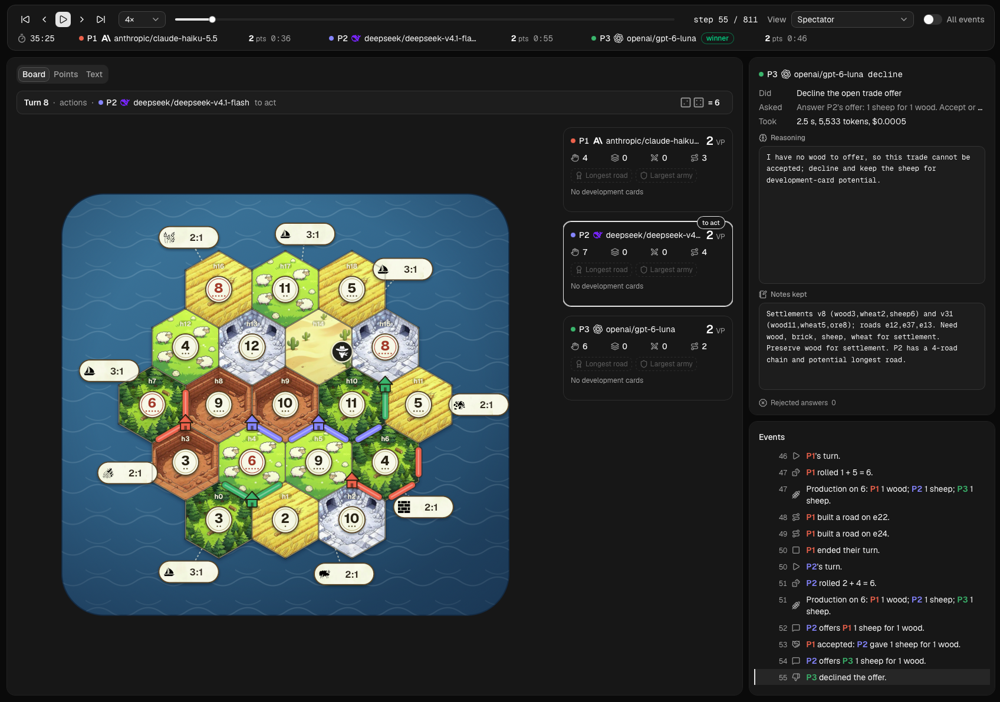

# LLM Boardgame Arena



Put a few LLMs around a board game table and watch them play. Every move gets logged along with what each model saw, what it was thinking and what it cost, so you can replay any match step by step afterwards.

There are four games so far:

- **Tic-tac-toe**, the 3x3 classic. Handy for quick, cheap tests.
- **Catan**, the base game for 3 or 4 players: settlements, cities, roads, harbours, trading, the robber and dev cards.
- **Puerto Rico**, the base game for 3 to 5 players: roles, plantations, buildings, colonists, trading and shipping.
- **Terra Mystica**, the base game for 2 to 5 players: terraforming, buildings, cults, power, shipping, towns and final scoring.

Tournaments are next on the list.

## Setup

You'll need Python 3.12+ and [uv](https://docs.astral.sh/uv/). The web viewer also needs Node.js 20.9+ and [pnpm](https://pnpm.io/).

```sh
git clone <repo-url> llm-bg-arena
cd llm-bg-arena
uv sync
pnpm --dir web install
pnpm --dir web build
```

Every player is a model on [OpenRouter](https://openrouter.ai/), so you'll need a key. Put it in a `.env` file in the project folder:

```
OPENROUTER_API_KEY=<your-key>
```

## Play a match

A match is a small YAML file: the game, a seed, and who sits where. This is `examples/tic_tac_toe.yaml`, two cheap models going at it:

```yaml
game: tic_tac_toe
seed: 7
seats:
  - model: qwen/qwen3.7-flash    # reasoning is off unless a seat asks for it
  - model: openai/gpt-5-nano
    reasoning_effort: low     # this model must think; low keeps replies short
```

```sh
uv run arena play examples/tic_tac_toe.yaml
```

That one costs well under a cent. Any OpenRouter model id works. A seat with no `model` gets `qwen/qwen3.7-flash`, and if you leave out `seats` altogether, everyone does. `examples/` also has short Catan, Puerto Rico and Terra Mystica games.

Things you can set per seat:

| Setting | What it does |
| --- | --- |
| `temperature`, `top_p`, `max_tokens` | The usual sampling knobs. `max_tokens` defaults to 4096 and includes any thinking. |
| `reasoning`, `reasoning_effort`, `thinking_budget_tokens` | Let the model think before it moves. Off unless you ask. Efforts go from `minimal` to `max`, and each model only takes some of them. |
| `verbosity` | Shorter or longer answers, for models that support it. |
| `label`, `persona` | A display name, and extra instructions like "play cautiously and trade often". |
| `max_illegal_retries`, `fallback` | How many second chances after an illegal move, and what to do after that: play a random move, the game's default move, or forfeit. |
| `output_mode: tools` | Let the model look at the state, the rules and the legal moves through tool calls before it answers. `max_tool_calls` caps how many. |
| `extractor` | A second model that rescues malformed replies. |
| `timeout_seconds`, `extra` | A time limit per reply, and raw options passed straight to OpenRouter. |

Players go by their `label`, or by their model if they don't have one. Two seats on the same model show up as `qwen/qwen3.7-flash #1` and `#2`. Add `cache: true` at the top of the file to reuse replies for identical requests, and use `--seed` or `--log` on the command line to override the file.

About reasoning: it's off by default because it makes moves slow. `qwen/qwen3.7-flash` ignores `low` and token budgets and will happily think for minutes about one move. `openai/gpt-5-nano` goes the other way and refuses to run with reasoning off, so give it `reasoning_effort: low`.

A couple of game notes:

- **Puerto Rico** follows the usual role cycle. The governor picks first, each role plays out right away, and roles nobody took collect a doubloon at the end of the round. For shorter games, lower `victory_point_supply` (the standard is 75/100/122 chips) or set `max_rounds`.
- **Catan** trades between players are one card for one card, dev cards are played after the roll, and offers are capped per turn so games keep moving.

Full rules and move notation for each game are in its `rules.md`, for example `boardgames/games/catan/rules.md`.

## Logs and replays

Each match leaves two files in `runs/`: a JSONL log, and a `.thoughts.md` with every model's reasoning, tool calls, rejected answers and notes. The thoughts file is written as the match goes, so you can follow along while it runs. `arena replay` rebuilds the match from its seed and checks the log move by move:

```console
$ uv run arena play examples/tic_tac_toe.yaml --log runs/demo.jsonl
tic_tac_toe (seed 7): P1 qwen/qwen3.7-flash, P2 openai/gpt-5-nano
    New game of tic-tac-toe.
[1] P1 qwen/qwen3.7-flash: b2
      reasoning: This is the first move of the game. I will choose the center square (b2) as it is the most strategic position, ...
    P1 (X) marked b2.
[2] P2 openai/gpt-5-nano: c3
      reasoning: I will block the key diagonal threat from X. With X at b2, the diagonal a1-b2-c3 could lead to a win for X ...
    P2 (O) marked c3.
...
[7] P1 qwen/qwen3.7-flash: b1
      reasoning: I have X at a1, b2, and c1. The bottom row (row 1) consists of cells a1, b1, and c1. ...
      rejected: The tool call needs a non-empty "action" string.
    P1 (X) marked b1.
    P1 (X) completed a line: a1 b1 c1.
Finished after 7 steps.
  #1 P1 qwen/qwen3.7-flash: 1 point (14508 tokens, $0.0007)
  #2 P2 openai/gpt-5-nano: 0 points (5021 tokens, $0.0013)
Ranks: P1 #1, P2 #2
Log: runs/demo.jsonl
Thoughts: runs/demo.thoughts.md

$ uv run arena replay runs/demo.jsonl
Replay matches the log: tic_tac_toe, 7 steps, 9 events.
```

## The viewer

```sh
uv run arena serve
```

Then open http://127.0.0.1:8765/. In there you can:

- Replay any match in `runs/` step by step: the board, what the model was asked, what it answered, its reasoning and notes, and points over time. You can switch to one player's view, or show the private events too.
- Check the leaderboard: Elo per game, plus win rate, how often a model's answers got rejected, latency, tokens and cost. Each model has its own page with its record against every opponent.
- Read each game's page, with its rules, default settings, standings and past matches.
- Start a new match. Pick a game, add players and choose a model for each. The form reads OpenRouter's model list, only shows settings a model accepts, and starts out cheap: reasoning off when the model allows it, lowest effort when it doesn't.

Matches started from the viewer run inside the server, so you can watch them live and pause, resume or stop them. Stopping keeps the log. You can delete old matches from the list or from their page.

`--runs` points at a different log folder, `--port` changes the port, and `--viewer` points at a different viewer build (`web/out` by default). If there's no build yet, `arena serve` tells you how to make one.

## Hacking on it

```sh
uv run pytest
uv run ruff check .
uv run mypy
pnpm --dir web lint
pnpm --dir web build
```

For live reload on the viewer, leave `uv run arena serve` running, start `pnpm --dir web dev` and go to http://localhost:3000/. The dev server sends `/api` calls to port 8765. If you change the API, `pnpm --dir web gen:api` regenerates the viewer's types from the running server.

## Credits

The game art and logos come from these projects. They're worth a look if you're into this kind of thing:

- Puerto Rico cards, tiles, barrels and boards: [Middlederg/puerto-rico](https://github.com/Middlederg/puerto-rico). That repo doesn't declare a licence.
- Catan terrain and sea art: [baige007/Catan-web-game-](https://github.com/baige007/Catan-web-game-) (MIT), which builds on [Erodenn/Simple-Catan](https://github.com/Erodenn/Simple-Catan).
- Catan port and robber icons: [game-icons.net](https://game-icons.net/), by Delapouite and Lorc (CC BY 3.0).
- Model provider logos: [lobehub/lobe-icons](https://github.com/lobehub/lobe-icons) (MIT).

`web/public/puerto_rico/SOURCE.md` and `web/public/catan/SOURCE.md` say where each file came from.
